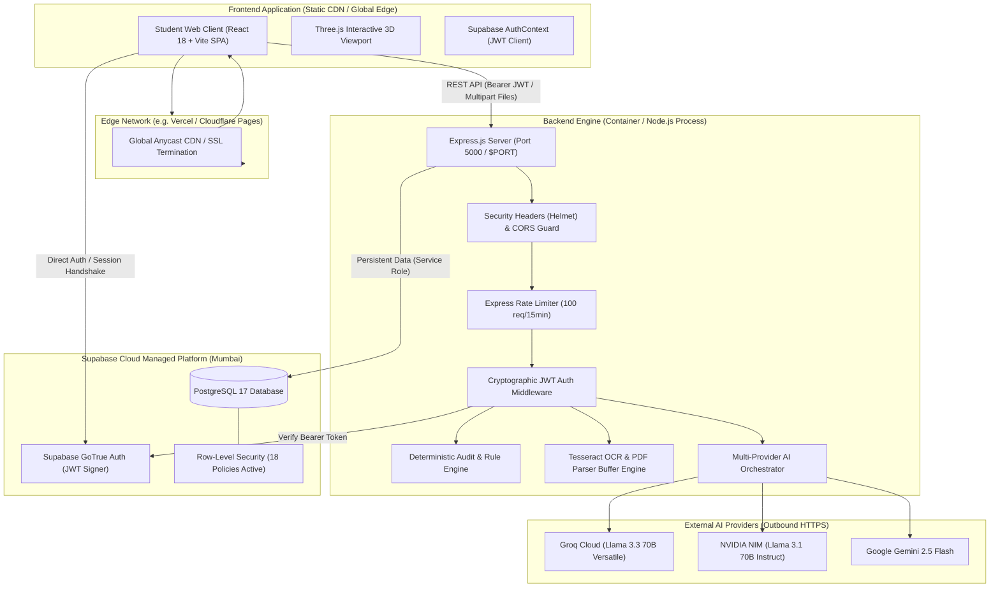

# QuestForge AI — Production Deployment Architecture & Hosting Report

**Document Version:** 1.0.0  
**Phase:** 12 — Production Deployment Preparation & Final Security Audit  
**Date:** November 2026  
**Project:** QuestForge AI (Academic Skill Enhancement Course Project)  
**Database Reference:** `bwllksfjjxmumrrqaifa` (South Asia - Mumbai, `ap-south-1`)  
**Git Checkpoint:** master  

---

## Executive Summary

QuestForge AI is a production-engineered, pre-submission scholarship document auditing and readiness assistant. The application has been evaluated, hardened, and verified for production deployment. This report analyzes the concrete architecture of the codebase, compares realistic hosting topologies, details build and execution parameters, and provides a clear operational roadmap.



---

## 1. Concrete Architecture Inspection

Based on the empirical inspection of `c:\SEC\`:

| Component | Technology | Implementation Details |
| :--- | :--- | :--- |
| **Frontend Framework** | React 18 + Vite 6 | Single Page Application (SPA), React Router v6, Lucide React icons, Tailwind CSS |
| **Client Bundling** | Code-Split Production Build | 27 chunks (`dist/`), total vendor payload ~165 kB (gzip: 54 kB), Three.js isolated chunk (526 kB / gzip: 130 kB), dynamic imports for all 16 page routes |
| **3D Rendering** | Three.js | Canvas viewports in `HeroCanvas.jsx` and `ModelCanvas.jsx`, with graceful WebGL fallback detection |
| **Backend Engine** | Node.js 20+ (ES Modules) | Express.js, native ES modules (`"type": "module"`), custom error middleware, Helmet security headers, rate limiting |
| **File Processing** | Volatile RAM Buffer Engine | `multer.memoryStorage()` — files remain in volatile memory and are **never** written to disk; binary magic-byte verification |
| **Text Extraction** | OCR & PDF Parsing | `pdf-parse` for digital PDFs, `tesseract.js` for scanned document image OCR |
| **AI Orchestration** | Multi-Provider Failover | Google Gemini &rarr; Groq Cloud &rarr; NVIDIA NIM &rarr; Deterministic regex/heuristic fallback |
| **Cloud Database** | Supabase PostgreSQL 17 | Hosted in Mumbai (`bwllksfjjxmumrrqaifa`), 6 production tables, 18 RLS policies, automated `handle_new_user` auth trigger |
| **Authentication** | Supabase Auth (GoTrue) | Cryptographic Bearer JWT tokens, server-side validation via Supabase Auth Admin API |

---

## 2. Hosting Options Comparison

QuestForge AI utilizes a decoupled frontend and backend. We evaluate top hosting solutions specifically tailored to the codebase requirements (Node.js buffer handling, memory limits for OCR, and static SPA delivery).

### 2.1 Frontend Hosting Evaluation

| Provider | Free Tier Limits | SSL / CDN | Custom Domain | Suitability Rating | Notes |
| :--- | :--- | :--- | :--- | :---: | :--- |
| **Vercel** *(Recommended)* | 100 GB bandwidth/mo, unlimited preview deployments | Automated Let's Encrypt, Anycast Edge | Free custom domains, automatic DNS verification | **9.8 / 10** | Zero configuration for Vite SPAs; simple `vercel.json` rewrite rule for client routing |
| **Cloudflare Pages** | Unlimited bandwidth, 500 builds/mo | Global Cloudflare Anycast, DDoS protection | Unlimited custom domains | **9.5 / 10** | Extremely fast worldwide CDN; native integration with Cloudflare DNS & WAF |
| **Netlify** | 100 GB bandwidth/mo, 300 build mins/mo | Automated Let's Encrypt | Free custom domain support | **9.0 / 10** | Requires `_redirects` file for SPA history fallback (`/* /index.html 200`) |
| **AWS S3 + CloudFront** | 1 TB bandwidth in AWS Free Tier (12 mo) | ACM SSL + CloudFront CDN | Route 53 or external DNS | **7.5 / 10** | Highest operational complexity; manual cache invalidation setup required |

### 2.2 Backend Hosting Evaluation

The backend requires at least 256MB–512MB RAM for `tesseract.js` image processing and in-memory multipart buffer parsing.

| Provider | Pricing / Free Tier | Cold Starts / Sleep | Memory / CPU | Suitability Rating | Notes |
| :--- | :--- | :--- | :--- | :---: | :--- |
| **Railway** *(Recommended for Reliability)* | \$5 monthly free credit on trial; \$5/mo Hobby plan | **Zero cold sleep** (runs 24/7) | Up to 8 GB RAM, 8 vCPU | **9.6 / 10** | Native Docker or GitHub repo deploy, predictable performance, excellent logs |
| **Render** *(Recommended for Zero Cost)* | Free Web Service (750 hours/mo) | **Spins down** after 15 min inactivity (~50s delay on next hit) | 512 MB RAM, 0.1 CPU | **8.8 / 10** | Great free option; cold starts can be mitigated via cron ping on `/api/health` |
| **Fly.io** | \$5 credit / pay-per-use micro VMs | Suspends to zero if unconfigured | 256MB–1GB RAM micro VMs | **8.6 / 10** | Multi-region support close to Mumbai (`bom`), requires `flyctl` CLI setup |
| **DigitalOcean App Platform** | \$5/mo basic container | **Zero cold sleep** | 512 MB RAM, 1 vCPU | **8.5 / 10** | Reliable, predictable fixed pricing; no true free tier |

---

## 3. Recommended Production Deployment Architecture

We recommend the **Vercel + Render (or Railway) + Supabase Cloud** architecture:

1. **Frontend:** Deployed to **Vercel** as a static Vite Single Page Application.
   - Global Anycast CDN, <30ms latency in South Asia.
   - Instant cache invalidation on Git pushes.
2. **Backend:** Deployed to **Railway** (or **Render Free Tier**) as a standalone Node.js container service.
   - Handles memory-safe document processing and OCR buffer streams.
   - Restricts CORS to the Vercel frontend origin.
3. **Database:** Hosted on **Supabase Cloud (Mumbai, `ap-south-1`)**.
   - Zero egress latency to Indian users.
   - Automated backups, managed connection pooling.

---

## 4. Build, Start & Health Check Parameters

### 4.1 Frontend Configuration
- **Root Directory:** `client/`
- **Build Command:** `npm run build`
- **Output Directory:** `dist`
- **SPA Routing Configuration (`vercel.json`):**
  ```json
  {
    "rewrites": [
      { "source": "/(.*)", "destination": "/index.html" }
    ]
  }
  ```
- **Environment Variables:**
  - `VITE_API_URL`: `https://api.yourdomain.com` (or Railway backend URL)
  - `VITE_SUPABASE_URL`: `https://bwllksfjjxmumrrqaifa.supabase.co`
  - `VITE_SUPABASE_ANON_KEY`: `eyJhbGciOi...` (Safe public anon key)

### 4.2 Backend Configuration
- **Root Directory:** `server/`
- **Build Command:** `npm install --omit=dev`
- **Start Command:** `node src/index.js`
- **Port Binding:** Reads `process.env.PORT || 5000`
- **Health Check Endpoint:** `GET /api/health` (HTTP 200, checks uptime, active operational mode, AI status)
- **Persistence Status Endpoint:** `GET /api/persistence/status` (HTTP 200, checks database connectivity)

---

## 5. Cost Considerations & Free-Tier Boundaries

| Component | Service | Free Tier Boundary | Low-Cost Paid Tier |
| :--- | :--- | :--- | :--- |
| **Frontend** | Vercel | 100 GB/month bandwidth (Free forever) | \$20/month (Pro) |
| **Backend** | Render / Railway | Render Free (750 hrs/mo, 512MB RAM) | Railway Hobby (\$5/mo) / Render Starter (\$7/mo) |
| **Database** | Supabase | 500 MB database, 50,000 monthly active users, 2 projects (Free forever) | \$25/month (Pro) |
| **AI Extraction (Primary)** | Groq Cloud | Free Tier (30 req/min, 14,400 req/day for Llama 3.3 70B) | Pay-as-you-go (\$0.59 / 1M tokens) |
| **AI Extraction (Secondary)**| NVIDIA NIM | 1,000 free API credits on developer tier | Pay-as-you-go |
| **AI Extraction (Tertiary)** | Google Gemini | Free tier rate limited or Pay-as-you-go | \$0.075 / 1M input tokens |
| **Custom Domain** | Cloudflare / Namecheap | N/A | \$8 – \$14 / year (`.ai`, `.org`, or `.com`) |
| **Total Estimated Cost** | — | **\$0.00 / month** (within free tier allowances) | **~\$5.00 – \$12.00 / month** |

> [!NOTE]
> For academic evaluation and demonstration, the application runs entirely within the **\$0.00 / month** free tier. If Render free tier is selected for the backend, keep-alive pings every 10 minutes can prevent cold spin-down.
